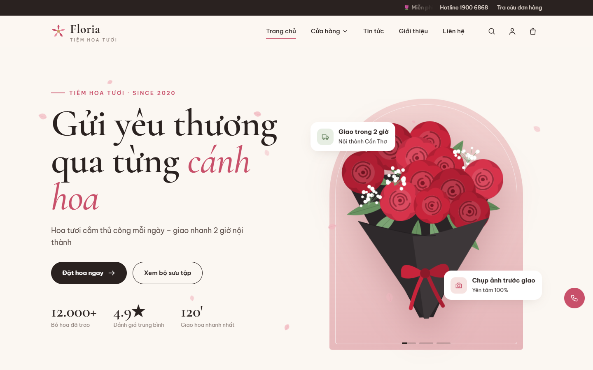

# 🌸 Floria – Website kinh doanh hoa tươi trực tuyến

Đồ án **Xây dựng website kinh doanh hoa tươi trực tuyến** – ASP.NET Core MVC (.NET 9) + SQL Server.

🌐 **Demo:** https://webbanhoa.onrender.com · 📄 **Báo cáo:** [docs/BaoCao_DoAn_WebsiteBanHoa.docx](docs/BaoCao_DoAn_WebsiteBanHoa.docx)



## Tính năng

**Khách hàng**
- Trang chủ hiện đại: slider hero, hiệu ứng cuộn ẩn/hiện (scroll reveal), parallax, cánh hoa rơi, marquee
- Xem sản phẩm theo **danh mục** và **dịp tặng**, tìm kiếm (có gợi ý tức thì), lọc theo giá, sắp xếp A–Z / giá / bán chạy, phân trang
- Chi tiết sản phẩm, sản phẩm liên quan, phóng to ảnh khi rê chuột
- Giỏ hàng AJAX (hiệu ứng bay vào giỏ, cập nhật số lượng không tải lại trang, thanh tiến trình miễn phí giao hàng)
- Đặt hàng: người gửi / người nhận, **ngày & khung giờ giao**, **lời nhắn thiệp** (xem trước trực tiếp)
- **Thanh toán online VNPay** (chuẩn 2.1.0, chữ ký HMAC-SHA512, IPN) hoặc COD; thanh toán lại khi lỗi
- Đăng ký / đăng nhập, quản lý tài khoản, lịch sử & hủy đơn, tra cứu đơn không cần đăng nhập
- Tin tức – cẩm nang hoa, giới thiệu, liên hệ
- Responsive tối ưu cho mobile, tablet, desktop

**Quản trị (`/admin`)**
- Dashboard: doanh thu, biểu đồ 6 tháng, trạng thái đơn, sản phẩm bán chạy, sắp hết hàng
- Quản lý danh mục, dịp tặng, sản phẩm (upload ảnh), slide, danh mục tin, tin tức
- Quản lý đơn hàng: duyệt theo quy trình *Chờ xác nhận → Đã xác nhận → Đang giao → Hoàn thành*, hủy đơn (hoàn kho), xác nhận thanh toán, lịch sử giao dịch VNPay, in hóa đơn
- Quản lý khách hàng (khóa/mở khóa), hộp thư liên hệ

## Tài khoản demo

| Vai trò | Tài khoản | Mật khẩu |
|---|---|---|
| Quản trị | `admin` | `Admin@123` |
| Khách hàng | `khach@floria.vn` | `Khach@123` |

Thanh toán VNPay (cổng sandbox mô phỏng): thẻ `9704 1985 2619 1432 198`, chủ thẻ `NGUYEN VAN A`, ngày phát hành `07/15`, OTP `123456`.

## Chạy trên máy (SQL Server)

Yêu cầu: .NET SDK 9, SQL Server (hoặc SQL Server Express/LocalDB).

```bash
cd WebBanHoa
dotnet run
```

Mở http://localhost:5118. Lần chạy đầu ứng dụng **tự tạo CSDL `WebBanHoa` và dữ liệu mẫu**.
Sửa chuỗi kết nối trong `WebBanHoa/appsettings.json` nếu cần, ví dụ LocalDB:
`Server=(localdb)\\MSSQLLocalDB;Database=WebBanHoa;Trusted_Connection=True;TrustServerCertificate=True`

Script SQL tạo bảng: [`Database/WebBanHoa_SqlServer.sql`](Database/WebBanHoa_SqlServer.sql).

## VNPay thật (sandbox)

Đăng ký merchant test tại https://sandbox.vnpayment.vn/devreg/ rồi điền `VnPay:TmnCode` và `VnPay:HashSecret`
(hoặc biến môi trường `VnPay__TmnCode`, `VnPay__HashSecret`). Khi để trống, hệ thống dùng **cổng thanh toán mô phỏng nội bộ** có cùng giao thức và chữ ký.

## Deploy lên Render

Repo có sẵn `Dockerfile` và `render.yaml` (Blueprint: web service Docker + PostgreSQL miễn phí).
Trên Render chọn **New → Blueprint** → chọn repo này → **Apply**. Khi có biến `DATABASE_URL`, ứng dụng tự chuyển sang PostgreSQL.

## Deploy lên VPS (đang chạy tại https://hoangtrung.vnc360.com)

- Ubuntu 24.04 + aaPanel. App build dạng *self-contained* `linux-x64` (không cần cài .NET), nằm ở `/www/wwwroot/hoangtrung.vnc360.com/app`.
- Chạy bằng systemd: `systemctl status|restart webbanhoa`, xem log: `journalctl -u webbanhoa -f`. Lắng nghe `127.0.0.1:5080`.
- CSDL: PostgreSQL 16 trên VPS (database/user `webbanhoa`); cấu hình bí mật trong `/etc/webbanhoa.env` (chỉ root đọc được).
- Nginx: `/www/server/panel/vhost/nginx/hoangtrung.vnc360.com.conf` (reverse proxy + HTTPS Let's Encrypt, certbot tự gia hạn).
- Cập nhật phiên bản mới: chạy `deploy/update-vps.sh` từ Git Bash.

## Cấu trúc

```
WebBanHoa/
├─ Areas/Admin/        # Trang quản trị (Controllers + Views)
├─ Controllers/        # Trang khách hàng
├─ Data/               # AppDbContext, DbSeeder (dữ liệu mẫu)
├─ Models/             # Entity + ViewModel
├─ Services/           # Giỏ hàng, VNPay, lưu ảnh
├─ Views/              # Razor views
└─ wwwroot/            # CSS, JS, ảnh minh hoạ SVG
Database/              # Script SQL
docs/                  # Báo cáo đồ án, ảnh chụp màn hình
tools/gen_flowers.py   # Sinh bộ ảnh minh hoạ hoa
```
